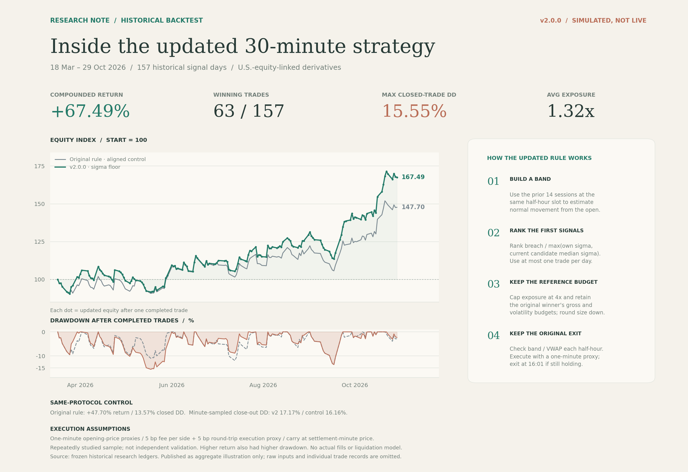
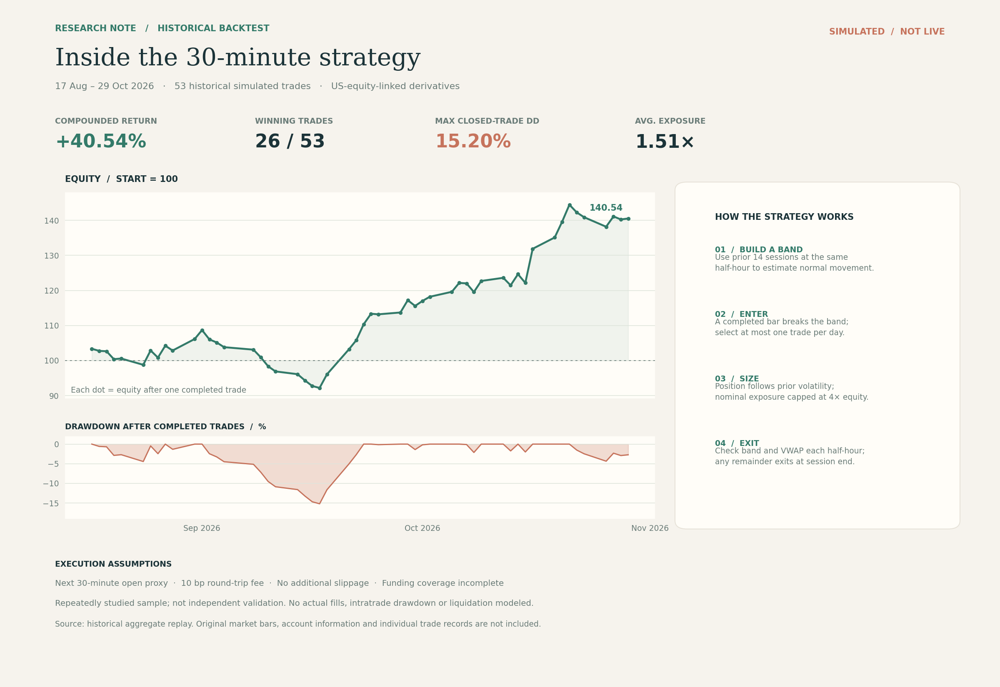

# 30-minute intraday momentum research

[中文](README.md) | [English](README.en.md)

**Current release: v2.0.0 · sigma floor. Initial release: v1.0.0.**

Runnable offline strategies, aligned version comparisons and research tools.
The update retains noise-band breakouts, the first signal slot and original
exits, while flooring the denominator used to rank simultaneous candidates.
No account connection or order submission is included.

## Updated strategy overview · v2.0.0



The initial figure's layout, palette and proportions are retained. Equity and
closed-trade drawdown appear on the left; the four strategy steps are on the
right. Green is v2; grey is the original signal rule under the **same execution
and cost protocol**. Each green dot is equity after one simulated trade.

Aligned historical replay, 157 signal days from 2026-03-18 to 2026-10-29:

- Original-rule control: **+47.70%** compounded return, **13.57%** closed
  drawdown, **16.16%** minute-sampled close-out drawdown.
- Sigma-floor update: **+67.49%** compounded return, **15.55%** closed
  drawdown, **17.17%** minute-sampled close-out drawdown; **63/157** profitable
  trades and approximately **1.32x** mean notional exposure.

This repeatedly examined historical sample is neither live performance nor
independent validation. Higher return also came with higher full-sample
drawdown. Minute opens are execution/settlement proxies, without actual order
book fills, intraminute extremes or liquidation. Original market data and
individual historical trade records are not distributed, so cloning alone
cannot independently reproduce this curve. See [aggregate evidence](evidence/historical-v2.0.0.json).

## Run both versions

Python 3.10+. Install the timezone dependency if required by your system.

```bash
git clone https://github.com/Gladst0ne-cle/intraday-momentum-research.git
cd intraday-momentum-research
python -m pip install -r requirements.txt
python scripts/run_replay.py --demo --compare
```

Demo prices are entirely fictional. They demonstrate the pipeline, **not the
historical chart or profitability**. The two rules may choose identical trades
on some inputs. Results go to `output/versioned/comparison.json` and one
subdirectory per version, each containing `summary.json`, `trades.csv`,
`equity.csv`, `minute_equity.csv` and `decisions.csv`. Repeated runs require
another output directory or explicit `--overwrite`.

```bash
# Updated version only
python scripts/run_replay.py --demo --config configs/v2.0.0.json --output output/v2
# Add another 20 bp round-trip execution cost to the base proxy
python scripts/run_replay.py --demo --compare --extra-cost-bps 20 --output output/stress20
# Export fictional inputs and run the complete CSV path
python scripts/run_replay.py --demo --compare --export-example output/example --output output/example-run
python scripts/run_replay.py --bars output/example/bars30.csv --minutes output/example/minutes.csv --specs output/example/specs.csv --carry-zero --compare --output output/from-files
# All tests
python -m unittest discover -s tests
```

Base assumptions are 5 bp commission per side plus a separate 5 bp round-trip
execution proxy, charged on each side's actual notional. Entry and exit wait
one minute after their decisions. User inputs require either explicit zero
carry or settlement events with verified declared coverage. Commission,
execution proxies and carry are separate cash components.

## What changed

```text
v1.0.0: select the largest raw breakout magnitude
v2.0.0: maximize breach / max(own sigma, median current candidate sigma)
```

The median uses only the first eligible slot's candidates, not future outcomes.
The replacement must satisfy the original winner's gross exposure and
volatility budgets. Reference exposure remains capped at 4x; entry costs are
reserved and quantity is rounded down. Bands, half-hour band/VWAP exits and
one trade per day remain. The new replay adds minute proxies, cash-component
accounting, settlement-time carry and minute risk sampling.

See [mathematics and version differences](docs/STRATEGY_VERSIONS.md),
[the complete running guide](docs/RUNNING.en.md) and [changelog](CHANGELOG.md).
The new engine's `configs/v1.0.0.json` is the **original signal under new
accounting**, not the legacy chart's execution protocol.

## Initial release retained · v1.0.0



The legacy chart covers 53 trades from 2026-08-17 to 2026-10-29: +40.54%
compounded return and 15.20% closed drawdown. It uses the next half-hour open,
10 bp round-trip commission, no added slippage and incomplete carry coverage.
It is not the aligned 157-day control above; do not directly subtract returns.

Original code and research tools remain usable with
`python src/simulate.py --demo`. See the [initial guide](docs/LEGACY.en.md)
and [legacy summary](historical_summary.json). Git tag `v1.0.0` preserves the
pre-update public repository; `v2.0.0` marks this release.

## Repository organization

- `scripts/`: recommended entry point; `configs/`: registered versions.
- `src/versioned_replay.py`: selection, causal exit planning, sizing and cash ledger.
- `src/replay_cli.py`: input validation, hashes, comparison and export.
- `src/intraday_momentum.py`, `backtest.py`, `simulate.py`: preserved original replay.
- `research/`: separate data-quality, filtering, risk, prediction and rolling
  evaluation tools; see [research guide](research/README.md).
- `tests/`: signal, budget, carry, missing-path and end-to-end regressions;
  `docs/`: bilingual guides and version definitions.
- `evidence/`: historical aggregates; `figures/`: finished images;
  `output/`: local results ignored by Git.

Only generic research code, aggregates and finished figures are published.
No credentials, accounts, trading interfaces, server configuration, raw market
inputs or individual historical records are included. Chart-rendering scripts
are intentionally omitted.

## Research background

Noise-band and intraday momentum ideas draw on *Beat the Market: An Effective
Intraday Momentum Strategy for the S&P 500 ETF (SPY)*. This is an independent
adaptation and extension, not a paper replication; the instruments and execution
environment differ. The reference does not validate this release's returns.
See the [initial guide](docs/LEGACY.en.md) for research background.
