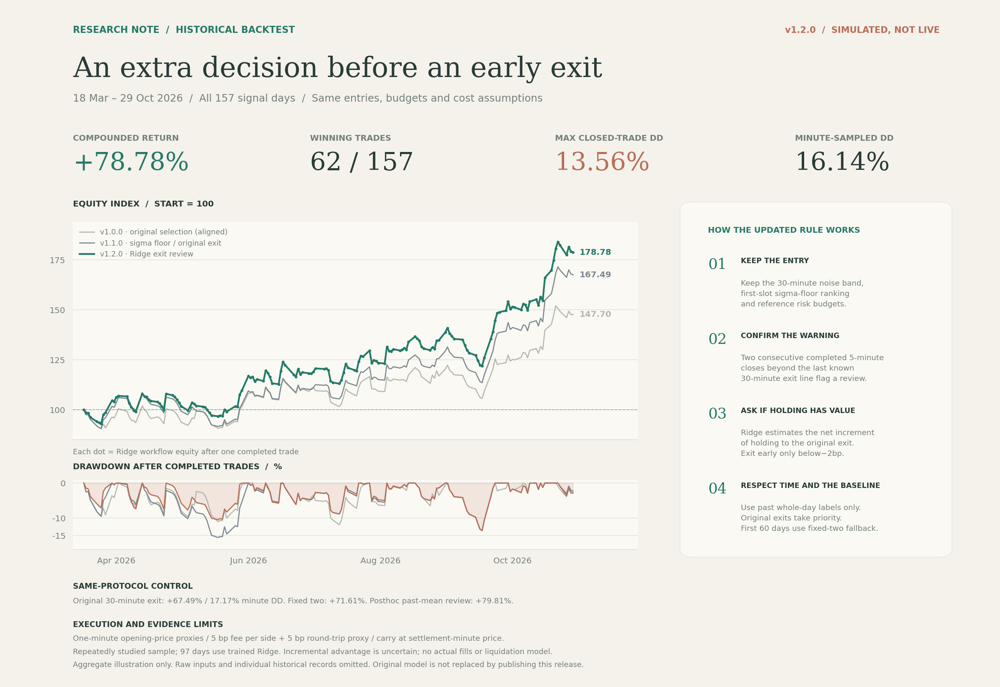
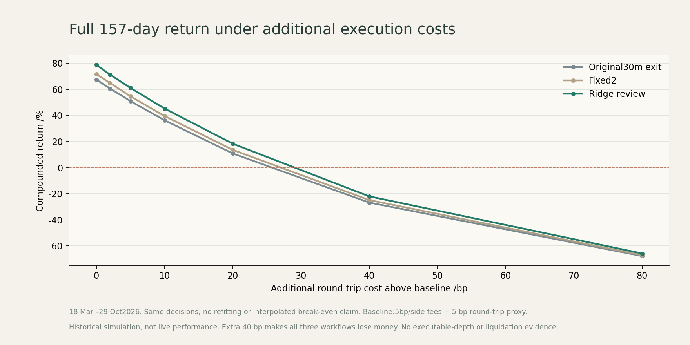

# Intraday Momentum Research · Ridge Exit Review

[中文](README.md) | [English](README.en.md)

**Current release: v1.2.0. Version line: v1.0.0 initial → v1.1.0 sigma-floor and minute replay → v1.2.0 Ridge exit review.**

Runnable offline strategies, chronological training, three-policy replay, cost stresses, paired block resampling and tests. Ridge reviews early-exit candidates while retaining the30-minute breakout, first signal slot, sigma-floor selection and reference risk budgets. No accounts or orders.

## Full157-day strategy overview · v1.2.0



The primary period is **18 March–29 October2026, all157 signal days, each starting from300 units and compounding independently**, with aligned entries, sizing and costs:

- v1.1.0 original 30-minute exit: **+67.49%**, final **502.48**; closed drawdown **15.55%**, minute-sampled close-out drawdown **17.17%**.
- Fixed two-confirmation control: **+71.61%**, final **514.84**; closed drawdown **13.90%**, minute drawdown **16.47%**.
- v1.2.0 Ridge workflow: **+78.78%**, final **536.33**; closed drawdown **13.56%**, minute drawdown **16.14%**; **62/157** winning trades.

**Repeatedly studied historical simulation, not live performance or new independent validation.** The first60 signal days use fixed-two fallback; only97 have trained Ridge predictions. Do not attribute the full return to learning. A posthoc constant-past-mean review reached+79.81%, above Ridge; incremental learning value is not established. Return is final/initial−1; position quantity already includes exposure.

Original market inputs and individual historical logs are omitted. A clone can run the fictional demo or your own inputs; it cannot independently reproduce this historical curve without those inputs. See [historical aggregates](evidence/historical-v1.2.0.json) and [robustness aggregates](evidence/robustness-v1.2.0.json).

## Clone and run

Python3.10+. Core training, inference and accounting use the standard library; requirements only add timezone support.

```bash
git clone https://github.com/Gladst0ne-cle/intraday-momentum-research.git
cd intraday-momentum-research
python -m pip install -r requirements.txt
python scripts/run_ridge.py --demo --config configs/v1.2.0.json --cost-grid --output output/ridge-demo
python scripts/check_ridge.py --run output/ridge-demo --block 5 --replications 1000 --output output/ridge-check.json
python -m unittest discover -s tests
```

The demo creates100 **fictional weekday sessions**, including deliberate intraminute excursions to exercise confirmation and training. These are neither actual calendar sessions nor observed prices. Demo results can lose money and are not evidence of historical performance. Existing output directories are refused.

Outputs include`summary.json`(all three full-period results, model boundaries and cost grid),`training.json`,`models/`, and per-policy`trades.csv`/`minute_equity.csv`.

## Your own inputs

```bash
python scripts/run_ridge.py --demo --export-example output/ridge-inputs --output output/ridge-export-run
python scripts/run_ridge.py --bars path/to/bars30.csv --minutes path/to/minutes.csv --specs path/to/specs.csv --carry-zero --cost-grid --output output/my-ridge
```

Minute CSV requires`symbol,timestamp_ms,open,high,low,close,volume`. At least15 complete prior sessions are required, with minute paths for the previous14 sessions of each first-slot candidate. Missing/duplicate/invalid inputs abort rather than being replaced by zero. Verify actual costs, calendars, timestamps and instrument units yourself. Supply carry events with verified coverage instead of`--carry-zero`when appropriate. Frozen models cannot predict dates preceding their training cutoff. See the[English manual](docs/RIDGE.en.md) or[中文手册](docs/RIDGE.zh-CN.md).

## Decision mechanism

1. Retain30-minute bands, first-slot sigma-floor ranking and original winner's gross/volatility budgets; reference exposure stays capped at4x.
2. Two completed5-minute closes beyond the last known completed30-minute exit line flag a review. The5-minute window must lie wholly after entry.
3. Ridge uses21 causally available features to estimate the net increment from holding until the original exit rather than exiting now. Exit early only below−2bp. Original exits always take priority. Fills use minute opens60seconds after decisions.
4. First60 signal days use fixed-two fallback. Refit every20 signal days using earlier complete days, with one whole signal-day embargo. All same-day candidates share the split; weights balance day/candidate/event. Future outcomes are targets, never features.

Baseline features/labels retain the frozen15bp round-trip cost; stresses keep predictions fixed. Equity compounds between trades. No re-entry, neural network or new exposure multiplier is added. See[design and usage](docs/RIDGE.en.md) and[version specifications](docs/STRATEGY_VERSIONS.md).

## Robustness and uncertainty



- Extra20bp round-trip cost reduces Ridge to **+18.33%**; extra40bp yields **−22.00%**, with minute drawdown about **37.13%**.
- Paired95% block-resampling intervals relative to both controls include zero incremental advantage.
- A39-repeat,5-day residual sign-randomization diagnostic, retaining past mean labels, has return tail ratio **0.90**. This is not future profit probability or a complete multiple-testing correction.
- Local source-input parity:833 candidate paths,24,200 feature states, zero feature error, maximum prediction difference about1.5e−17; all three 157-day cash paths match frozen research. **51 public tests** pass.

Some proxy order sizes exceed the exit minute's total volume; some endpoint minutes have no volume. Volume is not depth. Actual matching, marks, margin tiers and liquidation remain unverified. These tests cannot guarantee live profitability; publishing code does not replace any trading strategy.

## Code organization and versions

- `src/ridge_features.py`:21 causal features, volume-aware aggregation, original-exit priority.
- `src/ridge_model.py`:Ridge solver, unpenalized intercept, temporal boundaries and model checks.
- `src/ridge_replay.py`,`ridge_cli.py`:candidate preparation, rolling training, matched accounting and CSV workflow.
- `src/ridge_diagnostics.py`:paired block resampling and concentration diagnostics.
- `scripts/`:entry points;`configs/`:frozen settings;`models/`:latest historical model for dates after its cutoff.
- `tests/`,`docs/`,`evidence/`,`figures/`:tests, bilingual manuals, aggregates and finished images.
- `research/`:previous data-quality, signal, sizing and prediction baselines;`output/`:ignored local outputs.

v1.1.0 comparison remains`python scripts/run_replay.py --demo --compare`; the v1.0.0 entry remains`python src/simulate.py --demo`. The legacy53-trade+40.54% summary uses different dates and execution assumptions; do not subtract it from the157-day results. See[legacy notes](docs/LEGACY.en.md).

Versions describe compatible features, not returns. The obsolete v2.0.0 tag and Release are deleted, while source commits and the compatibility config remain. See[version numbering](docs/VERSIONING.md) and[changelog](CHANGELOG.md).

Only generic offline code, coefficients, aggregates and finished images are published. No venue-specific interfaces, accounts, credentials, servers, raw market inputs, individual historical records or figure-generation scripts.

## References

The noise-band idea is inspired by*Beat the Market: An Effective Intraday Momentum Strategy for the S&P500 ETF(SPY)*. This is an independent extension, not a replication or evidence that the paper validates Ridge. [PBO](https://www.davidhbailey.com/dhbpapers/backtest-prob.pdf) and[DSR](https://www.davidhbailey.com/dhbpapers/deflated-sharpe.pdf) inform the limits on repeated selection and non-normal returns.
