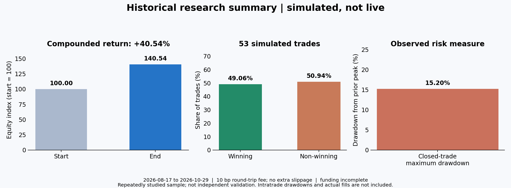

# 30-Minute Intraday Momentum Research

[中文](README.md) | [English](README.en.md)

This repository provides a self-contained 30-minute noise-band strategy and an **offline simulator**. After cloning, you can run an example with synthetic data or provide your own historical bars. The program does not connect to an account or submit orders. Example figures are not actual trading results.

## Historical simulation at a glance



Equity starts at 100; only the summarized start and end are shown, not a trade-by-trade equity curve. These are 53 historical simulated trades, not live performance or independent out-of-sample validation. Funding coverage is incomplete and drawdown excludes intratrade extremes. See the historical research summary below.

To regenerate the image, install `matplotlib` and run `python scripts/plot_historical_summary.py`; simulation itself does not require this dependency.

## Quick start

Python 3.10 or newer is required. No third-party Python packages are normally needed. If your system lacks the New York time-zone database, as can happen on Windows, first run `python -m pip install tzdata`.

```bash
git clone https://github.com/Gladst0ne-cle/intraday-momentum-research.git
cd intraday-momentum-research
python src/simulate.py --demo
```

`--demo` generates fictional price data locally and assumes zero carry. It starts with 10,000 units of simulated equity and assumes a total round-trip fee of 10 basis points. It produces:

- `output/simulation/trades.csv`: direction, entry and exit times and prices, leverage, net return, and equity before and after each trade.
- `output/simulation/summary.json`: trade count, win rate, compounded equity, maximum drawdown after completed trades, and the assumptions used.

To avoid overwriting results, use a different `--output` directory for another run, or explicitly add `--overwrite`. Use `--initial-equity 300` and `--fee-bps 15` to change starting equity and the **total round-trip** fee assumption.

```bash
python src/simulate.py --demo --initial-equity 300 --fee-bps 15 --output output/demo-300
python -m unittest discover -s tests
```

To inspect the full input format, export a **synthetic** bar file and replay it:

```bash
python src/simulate.py --demo --save-demo-bars output/example-bars.csv --output output/demo-export
python src/simulate.py --bars output/example-bars.csv --carry-zero --output output/from-csv
```

## Additional research tools

First run the `--demo` example above, then analyze the trades from that same run:

```bash
python src/research_analysis.py --trades output/simulation/trades.csv --summary output/simulation/summary.json
python src/rolling_evaluation.py --demo
```

The first command writes `output/research-analysis.json` with holding times, payoff statistics, additional cost scenarios of **0, 5, and 20 basis points**, and an after-the-fact sensitivity analysis that removes up to the three largest winners. Extra costs are added to the simulation's original round-trip fee and applied to notional exposure. Removing winners after the fact is not an executable trading rule, and a share of summed simple returns is not a share of compounded return.

The second command writes `output/rolling-evaluation.json`. It evaluates complete trading days in chronological segments, keeping at least 15 prior sessions before each segment. Each segment defaults to five evaluation days; a shorter final segment is marked. Equity resets to one for each segment, and segment drawdown is measured only after completed trades.

The segments use the **same fixed rules**; no model is retrained and no parameter is selected. If the data or parameters have already been studied, the segments do not constitute new independent out-of-sample validation. Both commands support `--output`; existing results are protected unless `--overwrite` is supplied. To evaluate your own bars in segments, replace `--demo` with the `--bars` and carry options described below.

## Use your own prices

Prepare a UTF-8 CSV with these columns:

```csv
symbol,timestamp_ms,open,high,low,close,volume
AAA,1767623400000,100,101,99,100.5,1200
```

`timestamp_ms` is the **UTC Unix timestamp in milliseconds** for the beginning of the bar. For each symbol and supplied trading day, provide all 13 half-hour bars beginning at 09:30, 10:00, ..., 15:30 New York time, plus a **16:00 row**. The program uses only the open of the final row as the session-close exit proxy. All symbols must cover the same dates. At least 15 complete prior sessions are required before the next day can be simulated.

The program checks the intraday grid, duplicate records, and OHLCV values, but **cannot detect every omitted holiday or early-close session**. Filter your data using an accurate market calendar. New York time conversion accounts for daylight saving time.

To explicitly assume zero carry:

```bash
python src/simulate.py --bars path/to/bars.csv --carry-zero --output output/my-run
```

Alternatively, provide a CSV of carry events with columns `symbol,timestamp_ms,rate`. Rates are decimals: a positive rate is paid by a long and received by a short. Events are included after entry and through the exit time. Declare the file's coverage start and end in Unix milliseconds. The program checks that each holding interval falls within the declared coverage, but **does not independently establish that the events are complete**.

```bash
python src/simulate.py --bars path/to/bars.csv --carry-file path/to/carry.csv \
  --carry-coverage-start 1767225600000 --carry-coverage-end 1798761600000 \
  --output output/my-run
```

Optional `--start 2026-03-01 --end 2026-06-30` limits the evaluation dates. The CSV must still include at least 15 complete sessions before the start date. The program uses earlier sessions and the current day's completed bars when making each decision; it does not train on future dates. Users must still verify that their data was available at the relevant decision times.

## Strategy and simulation assumptions

The strategy constructs noise bands from the average absolute move from the open at the same time over the previous 14 sessions. A half-hour close outside the upper or lower band creates a candidate. It selects at most one trade per day: the earliest signal takes priority, with candidates in the same period ranked by relative breach. Position size uses the sample volatility of the previous 14 close-to-close returns, a 4% volatility target, and a maximum notional exposure of four times equity. Subsequent half-hour closes are checked against the bands and session VWAP; any remaining position exits at the session close.

The simulation uses the **next half-hour open** as a fill proxy and compounds returns using current equity. It does not model actual spread, impact, queue position, latency, partial fills, margin, liquidation, or intratrade risk. Maximum drawdown is measured only after completed trades. If a simulated trade return is at or below −100%, the program raises an error instead of pretending to simulate liquidation.

## Historical research summary

One repeatedly examined historical test segment ending 2026-10-29 contained 53 trades, with **40.54%** simulated compounded return, a **49.06%** win rate, and **15.20%** maximum drawdown after completed trades. It used derivatives related to U.S. equities, next-half-hour opening-price proxies, a 10-basis-point round-trip fee, and no additional slippage; historical carry coverage was incomplete. These are not live returns or independent out-of-sample validation, and a few large winners materially affected the result.

The original bars and individual trades are not included, so **cloning this repository cannot reproduce the historical 40.54% figure**. The built-in data is fictional and only checks the workflow. See [historical_summary.json](historical_summary.json) for the summary.

The research is informed by [Beat the Market: An Effective Intraday Momentum Strategy for the S&P 500 ETF](https://concretumgroup.com/wp-content/uploads/2026/02/Beat-the-Market.pdf). This implementation differs in instruments, costs, and portfolio selection; the paper does not validate this repository's historical results.
