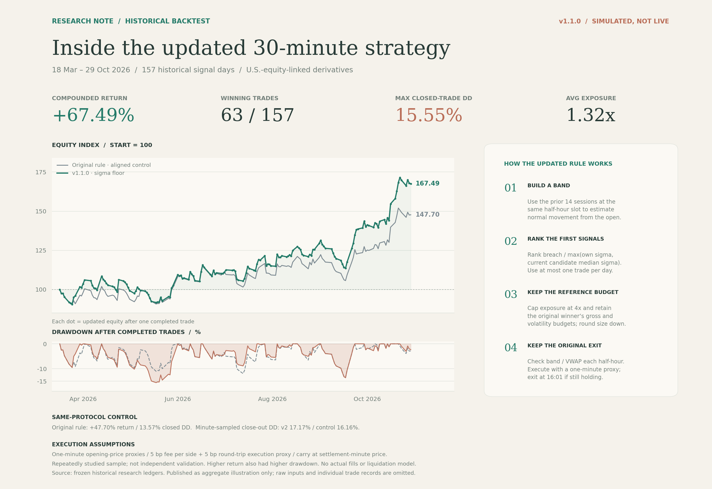
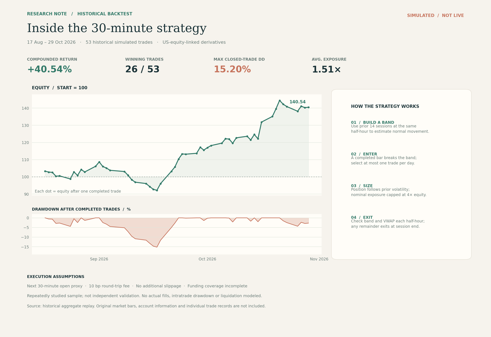

# 30 分钟日内动量策略研究

[中文](README.md) | [English](README.en.md)

**当前版本：v1.1.0 · 波动分母下限。初始版本：v1.0.0。**

可直接运行的离线策略、双版本对照和研究工具。保留噪声带突破、每日首个信号及原退出方式，在同一时点的候选排序中加入波动分母下限。所有程序均不连接账户、不下单。

## 更新后的全局策略图 · v1.1.0



沿用初始版的版式、配色和比例：左侧为全样本权益与已平仓回撤，右侧为四步策略。绿色是更新版，灰色是**同样成交和费用口径**下的初始信号规则；每个绿色点表示一笔历史模拟交易结束。

2026-03-18 至 2026-10-29，共 157 个信号日，同口径回放：

- 初始规则对照：复利 **+47.70%**，已平仓最大回撤 **13.57%**，分钟采样平仓估值回撤 **16.16%**。
- 分母下限更新：复利 **+67.49%**，已平仓最大回撤 **15.55%**，分钟采样平仓估值回撤 **17.17%**；盈利 **63/157** 笔，平均名义敞口约 **1.32 倍**。

这是反复研究过的历史模拟，不是实盘收益或独立验证。更新版并没有同时降低全样本回撤。分钟开盘价仍是成交/结算代理，不包含真实订单簿成交、分钟内极值或强平。原始行情及逐笔历史记录不公开，克隆仓库不能独立复现这条历史曲线。详见 [历史汇总](evidence/historical-v1.1.0.json)。

## 一条命令运行双版本

Python 3.10+。如缺少纽约时区数据，先安装 `requirements.txt`。

```bash
git clone https://github.com/Gladst0ne-cle/intraday-momentum-research.git
cd intraday-momentum-research
python -m pip install -r requirements.txt
python scripts/run_replay.py --demo --compare
```

演示行情完全虚构，展示完整运行链路，**不代表图中的历史数据或盈利证据**。两种规则可能在某些输入上选择完全相同的交易。结果保存在 `output/versioned/comparison.json` 和两个版本子目录中，包含 `summary.json`、`trades.csv`、`equity.csv`、`minute_equity.csv`、`decisions.csv`。重复运行需更换输出目录或明确加入 `--overwrite`。

```bash
# 单独运行更新版
python scripts/run_replay.py --demo --config configs/v1.1.0.json --output output/v1.1
# 成本压力：在基础代理成本之外，额外加双边合计 20 bp
python scripts/run_replay.py --demo --compare --extra-cost-bps 20 --output output/stress20
# 导出虚构行情与规格，再从 CSV 运行
python scripts/run_replay.py --demo --compare --export-example output/example --output output/example-run
python scripts/run_replay.py --bars output/example/bars30.csv --minutes output/example/minutes.csv --specs output/example/specs.csv --carry-zero --compare --output output/from-files
# 全部测试
python -m unittest discover -s tests
```

基础成本：每边 5 bp 手续费 + 双边合计 5 bp 执行成本代理，按进出场各自名义金额计算；入场和退出决策后均等待一分钟。使用自己的数据时必须明确零持仓费假设，或提供结算事件与已核实覆盖范围。手续费、代理滑点和持仓费是不同项目。

## 更新改变了什么

```text
v1.0.0：选取原始突破幅度最大的候选
v1.1.0：选取 breach / max(自身 sigma, 当前候选 sigma 中位数) 最大的候选
```

中位数仅使用当前首个有效信号时点的候选，不读取未来盈亏。更新后仓位同时受原始赢家的名义敞口预算和波动风险预算约束，参考敞口上限仍为 4 倍；预留入场费用，数量向下取整。原噪声带、半小时 band/VWAP 退出和每日最多一笔不变。新回放引擎补齐分钟价格、费用分解、结算时持仓费与分钟风险采样。

详见 [策略公式与版本差异](docs/STRATEGY_VERSIONS.md)、[详细运行手册](docs/RUNNING.zh-CN.md)、[版本更新记录](CHANGELOG.md)。新回放中使用 `configs/v1.0.0.json` 是**新执行口径下的原信号对照**，不能与旧图直接混用。

## 初始版本保留 · v1.0.0



旧图是 2026-08-17 至 2026-10-29 的 53 笔历史模拟，复利 +40.54%、已平仓最大回撤 15.20%，采用下一根半小时开盘价、双边 10 bp 手续费、无额外滑点且资金费覆盖不完整。它与上方 157 日同口径对照不同，不能直接相减判断更新收益。

初始代码和研究工具保留，旧入口 `python src/simulate.py --demo` 仍可用。[初始版完整说明](docs/LEGACY.zh-CN.md)与[旧汇总](historical_summary.json)可查。Git 标签 `v1.0.0` 保存更新前的公开仓库，`v1.1.0` 标记本次更新。

## 文件分类

- `scripts/`：推荐运行入口；`configs/`：版本配置。
- `src/versioned_replay.py`：排序、因果退出规划、仓位预算、分钟现金账本。
- `src/replay_cli.py`：CSV 校验、来源哈希、对照运行和导出。
- `src/intraday_momentum.py`、`backtest.py`、`simulate.py`：初始规则及旧回放。
- `research/`：数据质量、信号过滤、风险情景、简单预测与滚动验证等独立研究工具，见[研究手册](research/README.md)。
- `tests/`：规则、预算、结算、路径缺失和端到端回归；`docs/`：中英文手册。
- `evidence/`：历史汇总；`figures/`：成图；`output/`：本地输出，Git 忽略。

本次只公开通用研究代码、汇总与成图；不含账户、密钥、交易接口、服务器配置、原始行情或逐笔历史数据。制图脚本不上传。

## 研究背景

噪声带与日内动量思路参考 *Beat the Market: An Effective Intraday Momentum Strategy for the S&P 500 ETF (SPY)*；本仓库是独立改写与扩展，不是论文复现，研究标的与执行环境也不同。参考文献不是对本版本收益的背书。详情与原始研究工具见[初始说明](docs/LEGACY.zh-CN.md)。

版本编号已整理为1.x功能线，旧v2.0.0保留为历史标签与兼容入口。详见[版本编号说明](docs/VERSIONING.md)。
